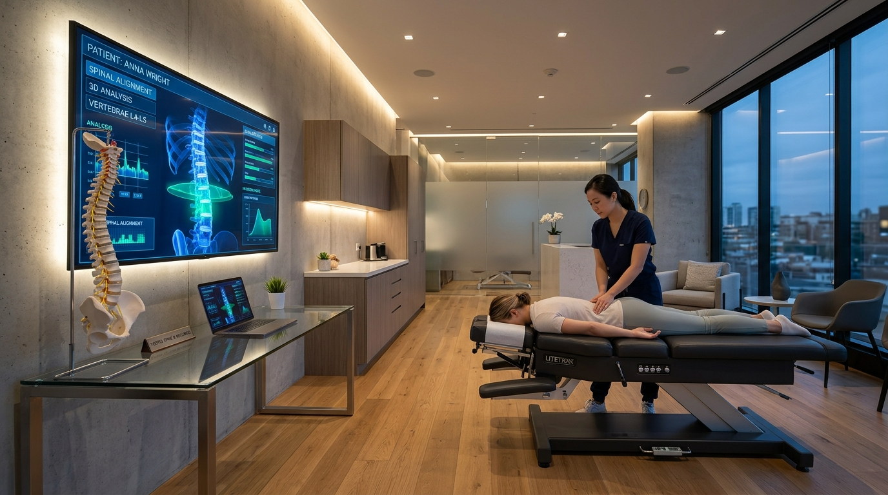

# Dr. Dany | Médico & Quiropráctico Especialista en Columna 🩺⚡

Sitio web oficial y landing page de alta conversión para los servicios quiroprácticos y médicos del **Dr. Dany** ([@elsuggardany](https://www.tiktok.com/@elsuggardany)).



---

## 🌟 Características Principales

- **Diseño Médico Moderno & Elegante:** Construido con paleta clínica premium (*Deep Obsidian*, *Emerald Glow* `#10b981`, *Bio-Cyan* `#06b6d4`), efectos de glassmorphism y microinteracciones fluidas.
- **Fotografías Reales:** Integración de imágenes y momentos del perfil oficial de TikTok (@elsuggardany) y tomas clínicas en alta resolución.
- **6 Servicios Especializados con Modales Informativos:**
  1. *Ajuste y Alineación Integral de Columna*
  2. *Alivio de Ciática y Dolor Lumbar Agudo*
  3. *Ajuste Cervical, Cuello y Cefaleas Tensionales*
  4. *Terapia Miofascial y Descarga Muscular Profunda*
  5. *Valoración Médica Completa & Análisis Radiológico*
  6. *Reeducación Postural & Biomecánica Preventiva*
- **Test Interactivo "¿Dónde Sientes el Dolor?":** Permite al paciente pulsar sobre un mapa anatómico 3D de columna (Cervical, Dorsal, Lumbar, Ciática, General) para recibir recomendaciones inmediatas y preparar su mensaje de WhatsApp.
- **Vitrina de TikTok & Casos Clínicos:** Destaca la serie insignia *"Diario de un Doctor"* con más de 107K seguidores y videos que superan los 5.8 millones de reproducciones.
- **Formulario de Citas Inteligente:** Formatea automáticamente la solicitud de consulta con datos médicos, turnos y síntomas para enviarlos directo al WhatsApp del consultorio en un clic.
- **Acordeón FAQ Interactivo:** Respuestas directas a dudas sobre dolor, cavitación articular ("tronar") y seguridad.
- **100% Responsivo:** Optimizado para smartphones, tablets y pantallas de escritorio.

---

## 🛠️ Tecnologías Utilizadas

- **HTML5:** Semántica médica, accesibilidad y metaetiquetas OpenGraph/SEO.
- **CSS3 Puro (Vanilla CSS):** Tokens de diseño, flexbox, grid, glassmorphism, keyframes y responsive queries.
- **JavaScript Moderno (ES6+):** Intersection Observer para animaciones al hacer scroll, modales accesibles, evaluador dinámico de síntomas y generador de enlaces de WhatsApp.
- **Google Fonts:** Tipografías *Outfit* y *Plus Jakarta Sans*.
- **FontAwesome 6.5:** Iconografía vectorial médica y social.

---

## 🚀 Cómo Ejecutar Localmente

No requiere instalación de dependencias pesadas ni compiladores:

```bash
# Clonar el repositorio
git clone https://github.com/MerlinMeneses/Medico-Dany.git

# Entrar a la carpeta
cd Medico-Dany

# Abrir directamente en el navegador o mediante un servidor local
python -m http.server 3000
```

Visita `http://localhost:3000` en tu navegador.

---

## 👨‍⚕️ Créditos

- **Profesional:** Dr. Dany — Médico y Quiropráctico ([TikTok: @elsuggardany](https://www.tiktok.com/@elsuggardany))
- **Desarrollado para:** Proyecto de Presencia Digital & Agenda de Pacientes
